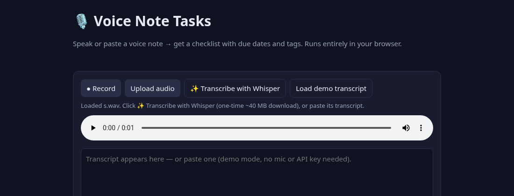

# 🎙️ Voice Note Tasks

Record (or paste) a voice note → transcript → structured checklist with **due dates**, **tags** and **priority**. 100% client-side: no server, no API keys, no build step.


## Features
- **Record** with the browser's Web Speech API (`SpeechRecognition`) — live transcript, plus the audio is kept for playback (MediaRecorder).
- **Upload audio** for playback, then optionally **✨ Transcribe with Whisper** — fully in-browser speech-to-text (see below). Or dictate/paste its transcript.
- **Demo mode** — paste any transcript (or click *Load demo transcript*, or open `/?demo`). Works with no mic and no keys.
- Parser extracts tasks and detects due dates (`today`, `tomorrow`, `Friday`, `next Monday`, `next week`, `in 3 days`, `November 1st`), **times** (`at 3pm`, `at 3:30 pm`, `at 17:45`, `at noon`), **weekly recurrence** (`every Monday`, `every Tuesday and Friday`, `on Mondays`, `weekly`), and splits **multi-clause** sentences (`call mom at 3pm and email Bob tomorrow` → 2 tasks, while `buy milk and eggs` stays 1). Auto-tags (`work`, `errand`, `call`, `home`, `health`, `money`) plus `#hashtags`, and `urgent/asap` → high priority.
- Edit titles inline, change dates, check off, delete. Saved to `localStorage`. Export as Markdown, JSON, or **`.ics` calendar** (dated tasks → events; timed tasks get a 30-min slot, others are all-day; recurring tasks get `RRULE:FREQ=WEEKLY;BYDAY=…`; urgent → `PRIORITY:1`). Import into Google Calendar, Apple Calendar or Outlook.

## Prerequisites
- A modern browser. Live recording needs Chrome, Edge or Safari (`SpeechRecognition`); Firefox works in paste/demo mode.
- Any static file server (mic access requires `localhost` or HTTPS). Node.js ≥ 18 *or* Python 3.

## Dependencies
**None required at runtime** — plain HTML/CSS/JS; record, paste and demo modes work fully offline.

**Optional (lazy-loaded, only when you click ✨ Transcribe with Whisper):**
| What | Size | Source |
|---|---|---|
| [`@huggingface/transformers`](https://github.com/huggingface/transformers.js) v3 (ES module) | ~1 MB JS + ONNX Runtime WASM | `cdn.jsdelivr.net` |
| [`Xenova/whisper-tiny.en`](https://huggingface.co/Xenova/whisper-tiny.en) (q8 quantized) | ~40 MB, downloaded once then cached by the browser | `huggingface.co` |

A progress bar shows the one-time download; after that transcription runs locally (no audio leaves your machine). If you're offline or the CDN is blocked, the app shows an error and paste/demo still work. English-only model; to change it edit `MODEL` in `whisper.js` (e.g. `Xenova/whisper-base`). `npm start` uses `npx serve` (fetched on demand); tests use only Node's built-in `assert`.

## Run
```bash
git clone https://github.com/YardPhantom/voice-note-tasks.git
cd voice-note-tasks
npm start                 # → http://localhost:5173
# or: python3 -m http.server 5173
npm test                  # parser tests
```
Open http://localhost:5173/?demo to see it pre-filled.

## Files
| File | Purpose |
|---|---|
| `parser.js` | Pure `parseTranscript(text, now)` → `[{id,title,due,tags,priority,done}]` (browser + Node) |
| `ics.js` | Pure `toICS(tasks)` → RFC 5545 calendar text (browser + Node) |
| `whisper.js` | Optional lazy-loaded Whisper transcription of uploaded files (ES module) |
| `app.js` | UI, speech recognition, recording, storage, export |
| `test.js` | Parser + `.ics` tests |

## Screenshots
| Empty | Demo | Upload → Whisper |
|---|---|---|
|  |  |  |

Screenshots are real headless Chrome captures of this app.

## License
MIT © Trevor Heshka — Built by [Trevor Heshka](https://trevorheshka.com)
