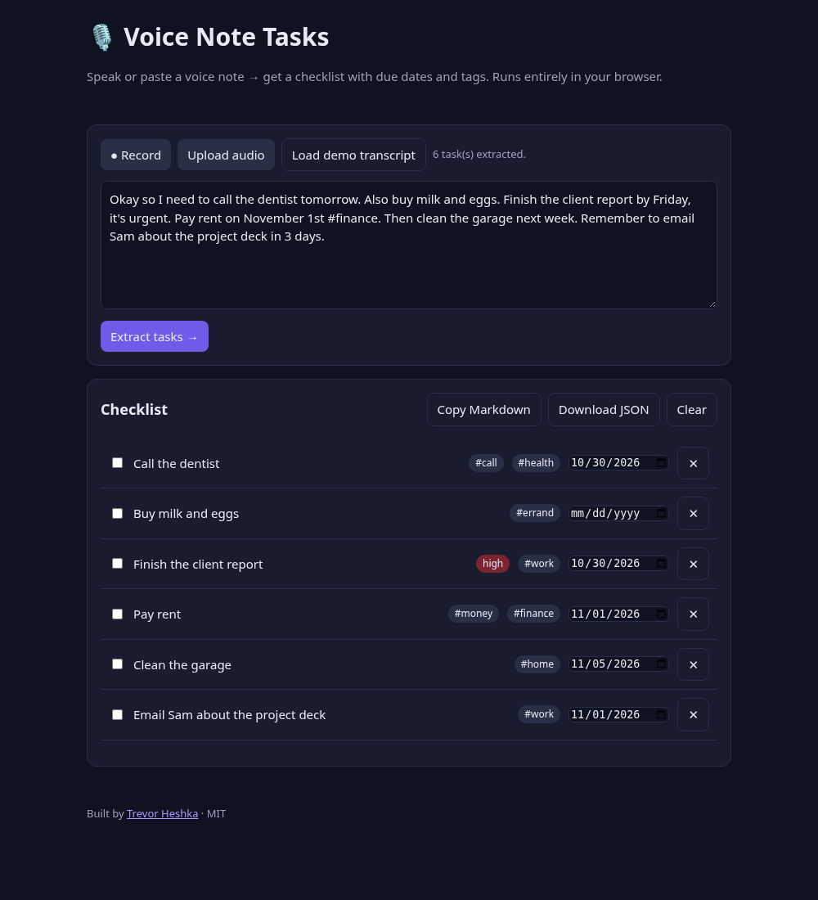
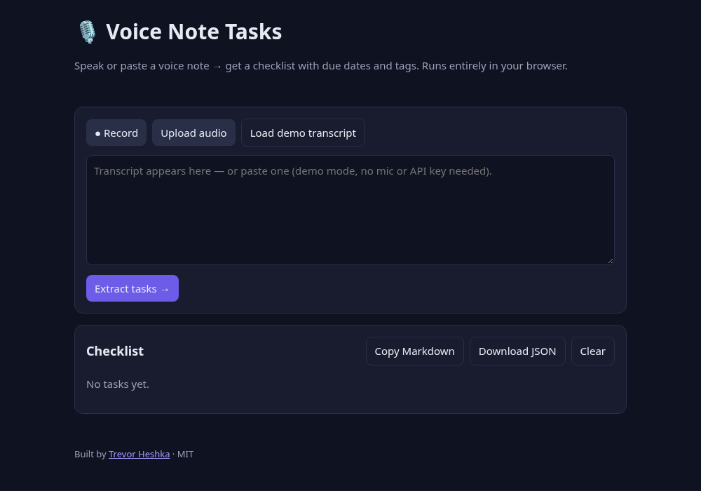

# 🎙️ Voice Note Tasks

Record (or paste) a voice note → transcript → structured checklist with **due dates**, **tags** and **priority**. 100% client-side: no server, no API keys, no build step.



## Features
- **Record** with the browser's Web Speech API (`SpeechRecognition`) — live transcript, plus the audio is kept for playback (MediaRecorder).
- **Upload audio** for playback; dictate or paste its transcript.
- **Demo mode** — paste any transcript (or click *Load demo transcript*, or open `/?demo`). Works with no mic and no keys.
- Parser extracts tasks and detects due dates (`today`, `tomorrow`, `Friday`, `next Monday`, `next week`, `in 3 days`, `November 1st`), auto-tags (`work`, `errand`, `call`, `home`, `health`, `money`) plus `#hashtags`, and `urgent/asap` → high priority.
- Edit titles inline, change dates, check off, delete. Saved to `localStorage`. Export as Markdown or JSON.

## Prerequisites
- A modern browser. Live recording needs Chrome, Edge or Safari (`SpeechRecognition`); Firefox works in paste/demo mode.
- Any static file server (mic access requires `localhost` or HTTPS). Node.js ≥ 18 *or* Python 3.

## Dependencies
**None at runtime** — plain HTML/CSS/JS. `npm start` uses `npx serve` (fetched on demand); tests use only Node's built-in `assert`.

## Run
```bash
git clone https://github.com/YardPhantom/voice-note-tasks.git
cd voice-note-tasks
npm start                 # → http://localhost:5173
# or: python3 -m http.server 5173
npm test                  # parser tests
```
Open http://localhost:5173/?demo to see it pre-filled.

## Files
| File | Purpose |
|---|---|
| `parser.js` | Pure `parseTranscript(text, now)` → `[{id,title,due,tags,priority,done}]` (browser + Node) |
| `app.js` | UI, speech recognition, recording, storage, export |
| `test.js` | Parser tests |

## Optional: offline Whisper
Not bundled, to keep zero dependencies. To transcribe uploaded files offline you could add [`@xenova/transformers`](https://github.com/xenova/transformers.js) (`Xenova/whisper-tiny.en`, ~40 MB download on first use) and set the textarea to its output — the parser is unchanged.

## Screenshots
| Empty | Demo |
|---|---|
|  |  |

Screenshots are real headless Chrome captures of this app.

## License
MIT © Trevor Heshka — Built by [Trevor Heshka](https://trevorheshka.com)
